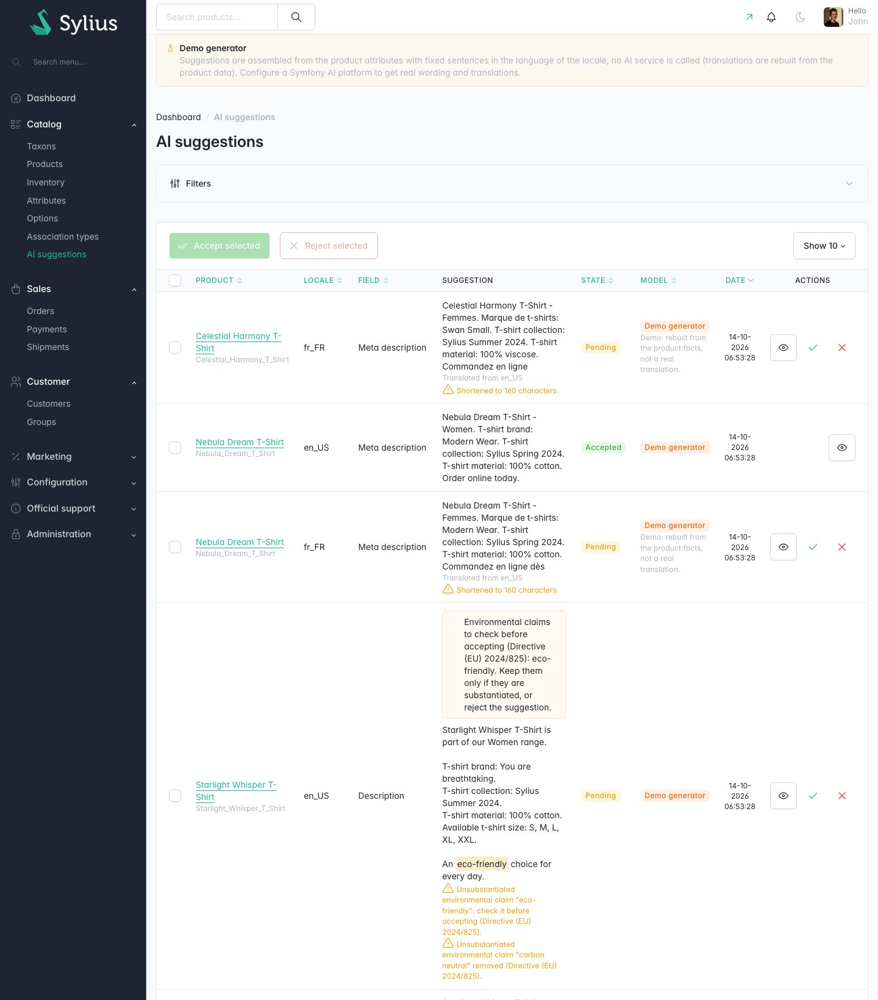
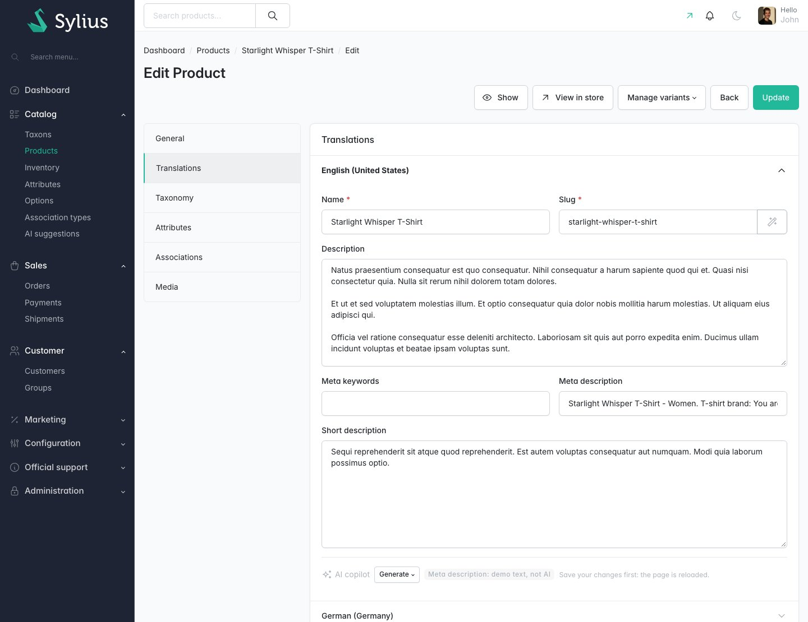
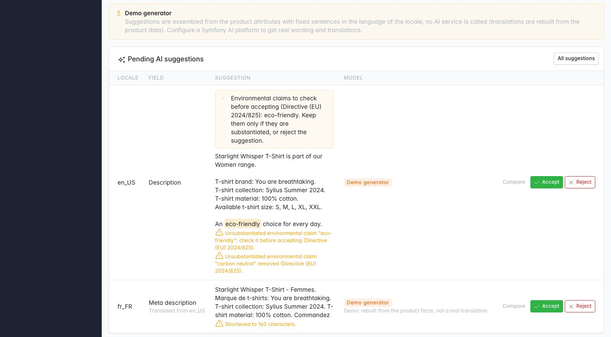
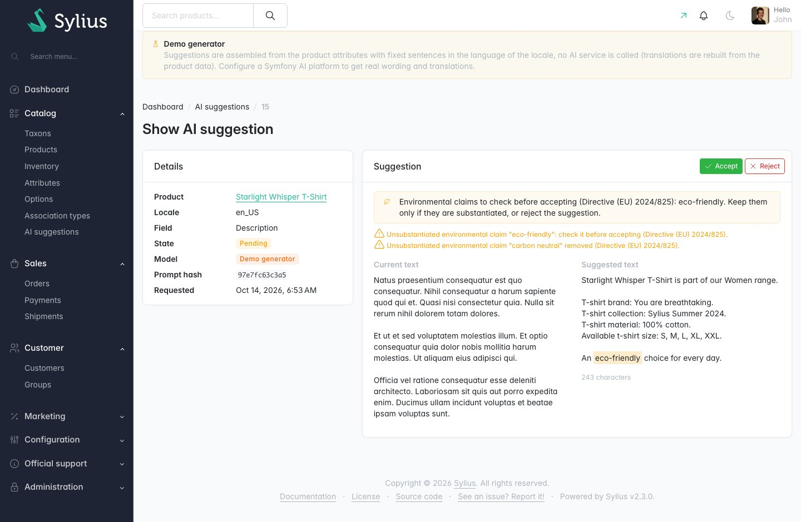
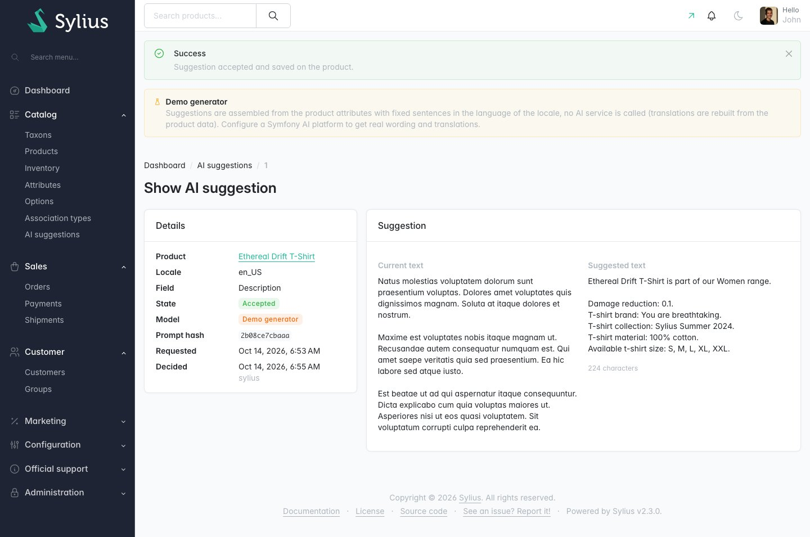

# Sylius AI Catalog Copilot Plugin

> Français : [README.fr.md](README.fr.md) <!-- vitrine:lang -->

[](https://github.com/thibmonier/sylius-ai-catalog-copilot-plugin/actions/workflows/build.yaml)
[](LICENSE)

**Reviewable AI suggestions for product descriptions, SEO metas and translations in the Sylius 2 back office.**

Writing and translating product texts is the slowest part of catalog work. Language models
are good at it, but a merchant cannot let them publish unreviewed texts: models invent
facts, and in the EU some claims ("eco-friendly", "carbon neutral") are now banned when they
are not substantiated.

This plugin asks the model of your choice (Mistral, OpenAI, Anthropic, a self-hosted Ollama...
through [Symfony AI](https://symfony.com/doc/current/ai/index.html)) for **suggestions**.
Nothing is written on a product until an administrator accepts it.

## Features

| Need | What the plugin does |
|---|---|
| Write the texts of a product | **AI copilot toolbar** in each locale of the product *Translations* tab: *Generate* the description, short description, meta description or meta keywords. |
| Translate a product | *Translate from &lt;default locale&gt;* in the other locales, field by field. |
| Keep control | Every answer becomes a **pending suggestion**. The product page lists them with **Accept** / **Reject**; a side-by-side page compares the current and the suggested text. Accepting writes the field server-side and reloads the page: the product form (a Live Component) is never modified in the browser. |
| Review in bulk | **AI suggestions grid** (Catalog menu) with filters (state, field, product, locale), accept / reject per row and **bulk accept / reject**. |
| Never overwrite a human | A suggestion is refused when the field changed since it was generated. Older pending suggestions of the same field are rejected when a new one is generated. |
| Facts, not hallucinations | Prompts give the model the product name, categories, attributes and options as the **only facts** it may state. They never contain customer data. |
| EU environmental claims | Generic claims ("eco-friendly", "green", "energy efficient", "écologique", "nachhaltigen", "ekologicznego", "biodegradable", "carbon neutral"... with their inflections in 7 languages) not backed by an ecolabel attribute are **flagged**: highlighted in the text, with a warning in the grid, the product page and the comparison page, before the reviewer accepts. Carbon / climate neutrality, net zero and offsetting claims (banned outright) are **always removed**. A `remove` mode removes every unsubstantiated claim. See [Legal](#legal-notes). |
| Clean output | Plain text only (HTML through Symfony HtmlSanitizer: the text of any element is kept, tables and lists become lines, scripts, styles and embeds are dropped, Markdown fences removed), length limits (meta description 50-160 characters, truncated on a word boundary), warnings shown on the suggestion. |
| Know what was AI-written | **Provenance markers**: model and dates stored for each field written from a suggestion, a badge in the admin, an optional shop notice and `data-ai-*` attributes. Texts of the demo generator are never presented as AI-generated. |
| Bulk generation | `tmonier:ai-copilot:generate --field=description --locale=en_US --only-empty` creates pending suggestions for many products (capped per run, with a cursor to continue). |
| Try it without an API key | The default **demo generator** assembles texts from the product facts with fixed sentences in the language of the locale (en, fr, de, es, it, nl, pl; English otherwise), without any AI call; "Translate from" rebuilds the text from the product data instead of translating. Its suggestions are clearly labelled in the admin. |
| Integrate | `AiSuggestionAccepted` event after each accepted suggestion. |

Also included: translations in English, French, German, Spanish, Italian, Dutch and Polish;
prompts as overridable Twig templates; Twig Hooks everywhere; MySQL, MariaDB and PostgreSQL support.

## Screenshots











## Requirements

| | Version |
|---|---|
| PHP | 8.2+ (Sylius 2.3 needs 8.3+) |
| Sylius | 2.2, 2.3 |
| Symfony | 7.4, 8.0 (Symfony 8 with Sylius 2.3 only) |
| Symfony AI | `symfony/ai-bundle` and `symfony/ai-platform` **0.14.x** |

Symfony 6.4 is not supported: Symfony AI requires Symfony 7.3+.

**Symfony AI is 0.x.** Each minor (about one a month) may break its API, so this plugin pins
`^0.14` (>= 0.14.0, < 0.15) and a new plugin version follows each Symfony AI minor (a weekly CI
job tests the next one). Until Symfony AI 1.0, the plugin cannot be installed next to a package
that pins another Symfony AI minor.

## Installation

1. Require the package, and the Symfony AI bridge of your provider when you use one:

    ```bash
    composer require tmonier/sylius-ai-catalog-copilot-plugin
    composer require symfony/ai-mistral-platform   # or ai-open-ai-platform, ai-anthropic-platform, ai-ollama-platform
    ```

2. Register the bundles in `config/bundles.php` (Symfony Flex does it automatically once a recipe exists):

    ```php
    Symfony\AI\AiBundle\AiBundle::class => ['all' => true],
    Tmonier\SyliusAiCatalogCopilotPlugin\TmonierSyliusAiCatalogCopilotPlugin::class => ['all' => true],
    ```

3. Import the configuration in `config/packages/tmonier_sylius_ai_catalog_copilot.yaml`:

    ```yaml
    imports:
        - { resource: "@TmonierSyliusAiCatalogCopilotPlugin/config/config.yaml" }
    ```

4. Import the admin routes in `config/routes/tmonier_sylius_ai_catalog_copilot.yaml`:

    ```yaml
    tmonier_sylius_ai_catalog_copilot:
        resource: "@TmonierSyliusAiCatalogCopilotPlugin/config/routes.yaml"
    ```

5. Run the migrations (two tables: `tmonier_ai_copilot_suggestion`, `tmonier_ai_copilot_provenance`):

    ```bash
    bin/console doctrine:migrations:migrate
    ```

The plugin now works with the **demo generator**: its fixed sentences only show the workflow. Real wording, and real translations of your texts, need a real model: plug one as below.

## Plugging a model

Platforms and credentials are configured with `symfony/ai-bundle`, from environment variables.
**No credential is ever stored in the database.** The plugin only needs the service id of the
platform (`ai.platform.<name>`) and a model name.

```yaml
# config/packages/ai.yaml
ai:
    platform:
        mistral:
            api_key: '%env(MISTRAL_API_KEY)%'
        # openai:
        #     api_key: '%env(OPENAI_API_KEY)%'
        # anthropic:
        #     api_key: '%env(ANTHROPIC_API_KEY)%'
        # ollama:
        #     endpoint: '%env(OLLAMA_HOST_URL)%'   # e.g. http://localhost:11434

# config/packages/tmonier_sylius_ai_catalog_copilot.yaml
tmonier_sylius_ai_catalog_copilot:
    generator:
        type: platform
        platform: ai.platform.mistral        # ai.platform.openai, ai.platform.anthropic, ai.platform.ollama
        model: mistral-small-latest           # any model name the platform knows
        options:
            temperature: 0.3
```

```dotenv
# .env.local - never commit it
MISTRAL_API_KEY=...
```

A self-hosted Ollama keeps product data on your servers. Whatever the provider, only catalog
data is sent (product name, code, categories, attributes, options, and the source text for a
translation).

To use something else (a local model, a proxy, a company gateway), implement
`Tmonier\SyliusAiCatalogCopilotPlugin\Generator\TextGeneratorInterface` and set
`generator: { type: service, service: app.my_generator }`.

Models newer than the Symfony AI model catalog of the installed minor (e.g. `claude-haiku-5-5`
with Symfony AI 0.14) are refused by the platform: set `model_class` to the bridge model class
(`Symfony\AI\Platform\Bridge\Anthropic\Claude` for Anthropic) to use any model id. The
generator `type` can also be an environment variable (`'%env(TMONIER_AI_GENERATOR)%'`, value
`demo` or `platform`), resolved at runtime; in `demo` mode the platform is never created. When the
platform cannot be created (e.g. missing API key), the admin shows an error message and nothing is
generated. API keys stay in environment variables: they are never stored in the database, shown
in the admin, or written in the logs (failures are logged with the exception class and message
only).

## Configuration

```yaml
# config/packages/tmonier_sylius_ai_catalog_copilot.yaml
tmonier_sylius_ai_catalog_copilot:
    generator:
        type: demo                  # demo (default, no AI call) | platform | service
    source_locale: ~                # locale of the "Translate from" buttons, default %locale%
    max_products_per_run: 50        # cap of tmonier:ai-copilot:generate
    environmental_claims:
        mode: flag                  # flag (default): keep and highlight for the reviewer | remove
                                    # neutrality / net zero / offsetting claims are removed in both modes
        recognised_labels: []       # extra recognised ecolabel names (EN ISO 14024 type I)
        ecolabel_attributes: [ecolabel, eco_label, eu_ecolabel, environmental_label, certification, certifications]
        biodegradable_attributes: [biodegradable, biodegradability, compostable, compostability]
    limits:                         # characters, per field
        meta_description: { min: 50, max: 160 }
        short_description: { max: 1000 }
    provenance:
        enabled: true               # record which fields come from accepted AI suggestions
        shop_notice: false          # show "written with AI" under the shop product description
    rate_limit:
        enabled: true               # limit AI generation calls from the admin UI (symfony/rate-limiter)
        per_admin: 30               # maximum generations per admin user per interval
        global: 300                 # maximum generations across all admins per interval
        interval: '1 hour'          # sliding-window interval
        cache_pool: cache.rate_limiter  # cache pool for rate-limiter state
```

The rate limiter uses two independent sliding-window counters: one per admin user (keyed by
`getUserIdentifier()`) and one global (keyed `'global'`). Both tokens are consumed on every
generation; if either counter is exhausted the request is denied with a flash error and the
product page is reloaded — nothing is generated. The admin can retry once their quota refills.
Set `enabled: false` if your infrastructure already throttles these routes, or if you run the
plugin in a context without a persistent cache (the CLI command is never rate-limited).

The `cache.rate_limiter` pool comes from Symfony's Rate Limiter component defaults. To use a
dedicated pool (recommended in production):

```yaml
framework:
    cache:
        pools:
            cache.my_copilot_limiter:
                adapter: cache.adapter.redis  # or filesystem, apcu…

tmonier_sylius_ai_catalog_copilot:
    rate_limit:
        cache_pool: cache.my_copilot_limiter
```

## Usage

- **Product page** (*Catalog > Products > Edit*, *Translations* tab): in each locale, *Generate*
  writes a field from the product facts; *Translate from ...* translates the field of the source
  locale. Save your changes first: the page is reloaded. The *Pending AI suggestions* card under
  the form lists the suggestions with *Accept*, *Reject* and *Compare*.
- **AI suggestions grid** (*Catalog > AI suggestions*): filter, accept or reject one row, or
  select rows and *Accept selected* / *Reject selected* (100 at most at once).
- **Command line**:

    ```bash
    bin/console tmonier:ai-copilot:generate --field=meta_description --locale=en_US --only-empty --dry-run
    bin/console tmonier:ai-copilot:generate --field=meta_description --locale=en_US --only-empty
    bin/console tmonier:ai-copilot:generate --field=description --locale=fr_FR --source-locale=en_US --product=SHIRT_01
    ```

    Products must already exist in the target locale. Products that already have a suggestion
    for the field in the locale (pending, accepted or rejected) are skipped; add
    `--include-processed` to regenerate the decided ones. `--only-empty` treats whitespace or
    markup-only texts as empty, and blank source texts are skipped. When a run reaches its limit
    it prints `--after-id=<id>` to continue with the next products. `--limit` must be a positive
    integer (capped by `max_products_per_run`).

## Customisation

- **Prompts** are Twig templates: `system.txt.twig` (rules), one template per field,
  `translate.txt.twig` and `_facts.txt.twig`. Override them in
  `templates/bundles/TmonierSyliusAiCatalogCopilotPlugin/prompts/`. Keep the rules of
  `system.txt.twig` (facts only, no environmental claims, plain text).
- **Product facts**: decorate `tmonier_ai_copilot.facts_extractor`
  (`ProductFactsExtractorInterface`) to add catalog data. Never add customer data.
- **Provenance in your templates**:

    ```twig
    <div {{ tmonier_ai_copilot_provenance_attributes(product, 'description') }}>{{ product.description|nl2br }}</div>
    {# data-ai-generated="true" data-ai-edited="false" data-ai-model="mistral-small-latest" data-ai-generated-at="2026-10-11T09:00:00+00:00" #}

    
    ...
    ```

    PHP code can use `ProvenanceProviderInterface`. A field rewritten by a human after the
    acceptance is reported as `edited` (`data-ai-generated="false"`); line endings and
    surrounding whitespace do not count as an edit. Texts of the demo generator are reported
    with `data-ai-generator="demo"` and `data-ai-generated="false"`, and never get the shop notice.
- **Events**: listen to `Tmonier\SyliusAiCatalogCopilotPlugin\Event\AiSuggestionAccepted`
  (suggestion, product, previous text, new text, administrator), dispatched after the flush.

### Sibling plugins

- [tmonier/sylius-audit-log-plugin](https://github.com/thibmonier/sylius-audit-log-plugin)
  records the product change made by an accepted suggestion, like any other admin change.
- [tmonier/sylius-bulk-actions-plugin](https://github.com/thibmonier/sylius-bulk-actions-plugin)
  could offer a "Generate AI suggestions" bulk action on the products grid (not done yet).

Both are optional: this plugin depends on neither.

## Legal notes

*This section is information, not legal advice. Check your obligations with a lawyer.*

- **EU AI Act, article 50(2)**: providers of AI systems generating text must mark the output in a
  machine-readable way. A merchant who runs this pipeline on its catalog may be considered a
  provider, and the open source exemption of article 2(12) does not cover article 50. The
  plugin therefore records the provenance of every accepted field by default (model, generation
  and acceptance dates) and can expose it as `data-ai-*` attributes and a shop notice. Article
  50(4) (texts published to inform the public on matters of public interest) does not target
  product pages. The application date of article 50 may be postponed by the "Digital Omnibus";
  at the time of writing that postponement was not published in the Official Journal.
- **Directive (EU) 2024/825** (empowering consumers for the green transition), applicable since
  27 September 2026: generic environmental claims ("eco-friendly", "green", "climate friendly",
  "biodegradable"...) are banned unless the product has a recognised excellent environmental
  performance (EU Ecolabel, an EN ISO 14024 type I ecolabel...), and claims of climate
  neutrality based on offsetting are banned outright (Annex I point 4c). The prompts forbid such
  claims, and the content guard looks for them in seven languages (stems with their
  inflections). By default (`mode: flag`) an unsubstantiated claim is **kept and highlighted**:
  the suggestion page, the product page and the grid mark it and warn the reviewer before
  acceptance, so that the reviewer decides (keep it only if it is substantiated, otherwise edit
  or reject). Carbon or climate neutrality, net zero, emissions-free and offsetting /
  compensation claims are **always removed**, in every mode. `mode: remove` also removes the
  sentences with other unsubstantiated claims.
  A generic claim is kept only when one of the `ecolabel_attributes` names a recognised label
  (e.g. *Certification: EU Ecolabel*) and the value contains no denying, expiry or pending word
  ("no", "not", "expired", "candidate", "pending", "abgelaufen"...); "biodegradable" or
  "compostable" only when one of the `biodegradable_attributes` starts with an explicit "yes"
  (oui, ja, sí, tak, certified...) or names a compostability standard (EN 13432...). Colour words are claims
  only in eco phrases ("green product", "greener", "produit vert"), never as plain colour
  adjectives, and not when the product name, attributes or option values give that colour.
  OEKO-TEX is not a claim. A kept claim is shown to the reviewer with the attribute that supports it.

  **The guard is a best-effort keyword filter, not legal advice.** It misses claims phrased in
  other ways and can flag (or, for neutrality claims and in `remove` mode, remove) a legitimate
  sentence: check the warnings. The administrator who accepts a suggestion remains responsible
  for the published text: read every suggestion before accepting it. National
  transpositions vary (France was still discussing it in October 2026).
- **Data protection**: prompts contain catalog data only, never customer data. Your provider's
  terms still apply to the product data you send; a self-hosted model avoids sending it.

## Limitations

- **Environmental claims guard: known gaps.** It is a best-effort keyword filter in seven
  languages; the reviewer stays responsible. Known gaps:
  - claims phrased as whole sentences ("we care about the planet", "inspired by nature", "a
    small step for the Earth") or in other languages are not detected;
  - a bare "öko" is not a claim (only "Öko-…" compounds); a bare "eco" is ignored next to
    "mode", "programme", "de"/"dell'" (echo) and similar words, so "Eco" used as a claim in such
    a context is missed;
  - "energy efficiency class / Energieeffizienzklasse / classe d'efficacité énergétique" is
    treated as the energy label, not as a claim;
  - colour phrases are limited to common nouns ("green product/choice/alternative"…); a colour
    given by the product exempts them, even when the text means the eco sense;
  - evidence values are read with word lists: a denial phrased differently ("we gave up the EU
    Ecolabel") can still be taken as evidence, and a value stating an unrelated restriction
    before the label name ("not tested on animals, EU Ecolabel") is rejected.
- One field at a time; no preview modal, no streaming. Generation is synchronous (a few seconds
  with a hosted model).
- No rate limiter or budget cap yet: only `max_products_per_run` for the command. Token counts are
  stored when the platform returns them.
- The content guard is keyword-based; it does not detect every invented fact or claim.
- A locale must exist on the product (name and slug saved) before texts can be generated in it.
- Product names, slugs, taxons and images are out of scope; no automatic publication.
- Sylius Plus RBAC is not integrated: every administrator can generate, accept and reject.

## Development

```bash
cp compose.override.dist.yml compose.override.yml   # publishes MySQL on 3306 and MailHog on 8025; change the ports if needed
docker compose up -d mysql mailhog
composer install
(cd vendor/sylius/test-application && yarn install && yarn build)
vendor/bin/console doctrine:database:create
vendor/bin/console doctrine:migrations:migrate -n
vendor/bin/console sylius:fixtures:load -n   # includes demo pending / accepted / rejected suggestions
symfony server:start -d --no-tls             # admin: /admin, sylius / sylius

vendor/bin/phpunit --testsuite unit
APP_ENV=test vendor/bin/phpunit --testsuite non-unit   # needs a test database with fixtures
vendor/bin/phpstan analyse
vendor/bin/ecs check
```

The test application uses the demo generator: no test, CI job or dev environment calls an AI
service. The Symfony AI adapter is tested against Symfony AI's `InMemoryPlatform`.


### Trying with a real model (Anthropic Claude)

The test application is wired to Anthropic but uses the demo generator unless told otherwise
(the tests and the CI always force the demo generator: no API call).

1. Put these lines in `tests/TestApplication/.env.local` (gitignored, never commit it):

    ```dotenv
    ANTHROPIC_API_KEY=sk-ant-...
    TMONIER_AI_GENERATOR=platform
    # optional, default claude-haiku-5-5 (cheapest); claude-sonnet-5-5 for better wording
    TMONIER_AI_MODEL=claude-haiku-5-5
    ```

2. Clear the cache: `vendor/bin/console cache:clear`.
3. In the admin, generate or translate a field again (*Generate* / *Translate from* in the
   product *Translations* tab), then review the pending suggestion.

Each click is one paid API call (a few hundred to a few thousand tokens). Only catalog data is
sent to Anthropic: product name and code, categories, attributes, options and, for a
translation, the source text; never customer data. Remove the lines (or set
`TMONIER_AI_GENERATOR=demo`) and clear the cache to go back to the demo generator.

<!-- vitrine:demo-b2b:start -->
## B2B demo

This plugin is used in the [Sylius B2B demo](https://github.com/thibmonier/sylius-b2b-demo): a Sylius 2.3 shop with fictitious sample data where the B2B plugins work together. The source code, setup and fixtures of the demo are in that repository.

- Online demo: [sylius-b2b.thibaut-monier.fr](https://sylius-b2b.thibaut-monier.fr)
- Author: [Thibaut Monier](https://www.linkedin.com/in/thibautmonier/)

The demo is an example, not a production setup.
<!-- vitrine:demo-b2b:end -->

## License

MIT. See [LICENSE](LICENSE).
